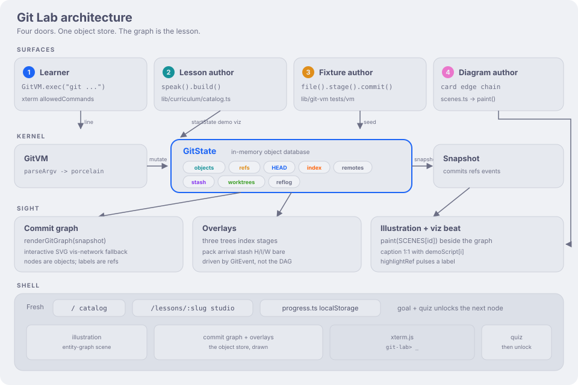
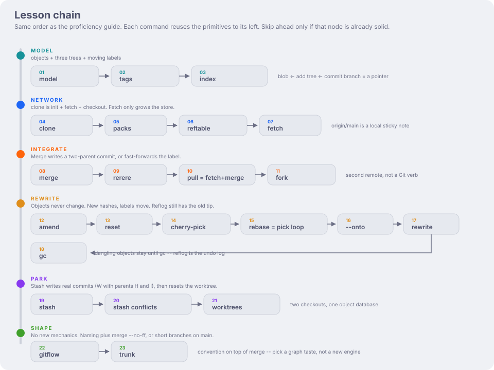

# Git Lab

Interactive [Deno](https://deno.com) / [Fresh](https://fresh.deno.dev) lab for learning Git as a **content-addressable graph**: objects, three trees, and moving labels — not a folder of copies.

Type real porcelain in a fake terminal. The object store is drawn beside you. Built for visual STEM learners: the picture is the lesson.

## Architecture

Four surfaces, one in-memory store. A keystroke never edits history. Porcelain mutates `GitState`; `snapshotOf` is what the graph, overlays, and captions consume.



The learner types `git …`. Authors seed a lesson with `speak().build()`, a fixture with `file().stage().commit()`, a diagram with scene ops. Fresh serves `/` (catalog) and `/lessons/:slug` (studio). Goal + quiz in `progress.ts` unlocks the next node.

## Lesson chain

Twenty-three lessons, one unlock at a time. The command spine is the proficiency-guide DAG: **clone then fetch**, **merge then pull then fork**. Internals sit beside the picture they explain — packs and reftable after fetch, rerere after you have merged three ways, tags just before GitFlow names a release.



Later verbs are earlier primitives glued together: **pull** is fetch then merge, **rebase** is reset then cherry-pick in a loop, **stash** is real commits (W with parents H and I), **worktrees** are extra checkouts of the same object database. GitFlow and trunk add no new engine — they are graph taste.

## Run locally

The CLI binary is **`deno`**. It is not `demo`.

```bash
curl -fsSL https://deno.land/install.sh | sh   # or: brew install deno
cd git-lab
deno install
deno task dev
```

Open the URL Vite prints (usually http://localhost:5173). `deno.json` sets `"nodeModulesDir": "manual"`, so `deno install` writes `node_modules`.

```bash
deno task test
```

`deno task check` also runs `deno fmt --check`. Some older CSS is unformatted; `deno task test` is the green suite.
